# Artory Database Schema Documentation

This document provides a comprehensive technical reference for the Artory MongoDB database schema managed via the Mongoose ODM. It details all 24 collections, their schema definitions, data types, constraints, default values, indexes, relational mappings (1:1, 1:N, N:M), embedded subdocument structures, and an architectural Entity-Relationship (ER) diagram.

---

## 1. Entity-Relationship Diagram (Mermaid.js)

```mermaid
erDiagram
    %% Core Entities & Users
    User ||--o| Admin : "1:1 has profile (ref)"
    User ||--o| UserInterest : "1:1 preferences (ref)"
    User ||--o| VerificationRequest : "1:1 identity verify (ref)"
    User ||--o| Mentor : "0..1:1 mentor profile (ref)"
    User ||--o{ User : "N:M follows (ref array)"

    %% Creative Content
    User ||--o{ Artwork : "1:N creates (ref)"
    Artwork ||--o{ Comment : "1:N receives (ref array & foreign key)"
    User ||--o{ Comment : "1:N writes (ref)"
    Comment ||--o{ Comment : "1:N replies to (ref self-loop)"
    Artwork }o--o{ User : "N:M likes (ref array)"

    User ||--o{ Comic : "1:N authors (ref)"
    Comic ||--o{ ComicEpisode : "1:N embeds episodes"
    Comic }o--o{ User : "N:M likes / follows (ref array)"

    User ||--o{ VideoTutorial : "1:N uploads (ref)"
    User ||--o{ ArtHistory : "1:N contributes (ref)"

    %% E-Commerce & Marketplace
    User ||--o{ Product : "1:N lists as artist (ref)"
    User ||--o{ Order : "1:N purchases as buyer (ref)"
    Order ||--|{ OrderItem : "1:N embeds items"
    OrderItem }|--|| Product : "references (ref)"

    %% Custom Art Commission Marketplace
    User ||--o{ ArtRequest : "1:N commissions as client (ref)"
    User ||--o{ ArtRequest : "1:N accepted as artist (ref)"
    ArtRequest ||--o{ Application : "1:N receives proposals (ref)"
    User ||--o{ Application : "1:N submits (ref)"
    ArtRequest ||--o| Chat : "1:1 dedicated chat (ref)"
    Application ||--o| Chat : "1:1 tied to proposal (ref)"
    Chat ||--|{ ChatMessage : "1:N embeds messages"
    ArtRequest ||--o{ Review : "1:N receives review (ref)"
    User ||--o{ Review : "1:N artist rated (ref)"
    User ||--o{ Review : "1:N client reviewer (ref)"

    %% Social, Communities & Groups
    User ||--o{ Community : "1:N creates (ref)"
    Community }o--o{ User : "N:M members / mods (ref array)"
    Community ||--o{ CommunityMessage : "1:N channel messages (ref)"
    User ||--o{ CommunityMessage : "1:N sends (ref)"

    User ||--o{ Group : "1:N creates (ref)"
    Group }o--o{ User : "N:M members (ref array)"
    Group ||--o{ GroupMessage : "1:N group messages (ref)"
    User ||--o{ GroupMessage : "1:N sends (ref)"

    User ||--o{ Message : "1:N direct sends (ref)"
    User ||--o{ Message : "1:N direct receives (ref)"

    %% Competitions, Moderation & Notifications
    User ||--o{ Competition : "1:N organizes (ref)"
    Competition }o--o{ User : "N:M participants (ref array)"
    Competition ||--o{ CompetitionSubmission : "1:N embeds submissions"
    Competition ||--o{ CompetitionWinner : "1:N embeds winners"

    User ||--o{ Notification : "1:N receives (ref)"
    User ||--o{ Notification : "1:N triggers (ref)"

    User ||--o{ Report : "1:N files report (ref)"
    Report }o--|| TargetEntity : "polymorphic ref (Artwork, User, Comic, etc.)"
```

---

## 2. Collections & Schema Details

### 2.1 `users` (User Model)
Central user entity containing profile details, role-based access attributes, social references, and bilateral followers.

| Field | Type | Required | Default | Constraints & Rules | Description |
| :--- | :--- | :--- | :--- | :--- | :--- |
| `_id` | `ObjectId` | Yes | Auto | Unique PK | Internal MongoDB Identifier |
| `username` | `String` | Yes | None | `unique: true`, `trim: true` | Unique username handle |
| `email` | `String` | Yes | None | `unique: true`, `lowercase: true` | Primary login and notification email |
| `password` | `String` | Yes | None | Hashed with bcrypt | Salted password hash |
| `age` | `Number` | No | `null` | `min: 1`, `max: 120` | User age |
| `bio` | `String` | No | `""` | None | User profile biography |
| `profileImage`| `String` | No | `""` | None | URL to avatar image |
| `coverImage` | `String` | No | `""` | None | URL to profile header banner |
| `skills` | `[String]` | No | `[]` | None | Artistic skills (e.g. Oil, Sketch) |
| `artInterests`| `[String]` | No | `[]` | None | Style preferences (e.g. Anime, Realism) |
| `followers` | `[ObjectId]`| No | `[]` | `ref: 'User'` | Array of user IDs following this account |
| `following` | `[ObjectId]`| No | `[]` | `ref: 'User'` | Array of user IDs this account follows |
| `isVerified` | `Boolean` | No | `false` | None | KYC/Artist verification status |
| `role` | `String` | No | `'user'` | Enum: `['user', 'mentor', 'admin']` | RBAC authorization role |
| `socialLinks` | `Object` | No | `{}` | Embedded Subdocument | External social links (see below) |
| `socialLinks.instagram` | `String` | No | `""` | None | Instagram handle/URL |
| `socialLinks.twitter` | `String` | No | `""` | None | X/Twitter handle/URL |
| `socialLinks.website` | `String` | No | `""` | None | Personal portfolio URL |
| `createdAt` | `Date` | Auto | Timestamp | Mongoose timestamps | Account creation date |
| `updatedAt` | `Date` | Auto | Timestamp | Mongoose timestamps | Last profile modification date |

**Indexes:**
- `{ username: 1 }` (unique)
- `{ email: 1 }` (unique)

**Relationships:**
- `followers` / `following`: N:M self-referencing relationship stored as ObjectId arrays (`ref: 'User'`).
- 1:1 with `admins` via `Admin.user`.
- 1:1 with `userinterests` via `UserInterest.userId`.
- 1:1 with `verificationrequests` via `VerificationRequest.applicant`.
- 1:N with `artworks`, `comics`, `products`, `orders`, `comments`, `artrequests`.

---

### 2.2 `admins` (Admin Model)
Metadata record extending privileged users with departmental permissions and access tiers.

| Field | Type | Required | Default | Constraints & Rules | Description |
| :--- | :--- | :--- | :--- | :--- | :--- |
| `_id` | `ObjectId` | Yes | Auto | Unique PK | Internal MongoDB Identifier |
| `user` | `ObjectId` | Yes | None | `ref: 'User'`, `unique: true`, `index: true` | Associated User account |
| `securityLevel` | `String` | No | `'moderator'` | Enum: `['super', 'moderator', 'support']` | Administrative authority tier |
| `departments` | `[String]` | No | `[]` | None | Managed areas (e.g. `users`, `billing`) |
| `permissions` | `[String]` | No | `[]` | None | Granular operations (e.g. `delete_user`) |
| `isActive` | `Boolean` | No | `true` | None | Status toggle for admin privileges |
| `createdAt` | `Date` | Auto | Timestamp | Mongoose timestamps | Timestamp |
| `updatedAt` | `Date` | Auto | Timestamp | Mongoose timestamps | Timestamp |

**Indexes:**
- `{ user: 1 }` (unique)

**Relationships:**
- 1:1 with `User` via `user` ObjectId ref.

---

### 2.3 `artworks` (Artwork Model)
Showcase artworks uploaded by artists, supporting rich media, tagging, and engagement metrics.

| Field | Type | Required | Default | Constraints & Rules | Description |
| :--- | :--- | :--- | :--- | :--- | :--- |
| `_id` | `ObjectId` | Yes | Auto | Unique PK | Internal MongoDB Identifier |
| `title` | `String` | Yes | None | None | Title of artwork |
| `description` | `String` | No | `""` | None | Description, inspiration, or caption |
| `imageUrl` | `String` | Yes | None | None | URL of the primary image asset |
| `videoUrl` | `String` | No | `""` | None | Optional process or timelapse video URL |
| `category` | `String` | No | `'other'` | Enum: `['painting', 'digital', 'sketch', 'calligraphy', 'sculpture', 'photography', 'comic', 'other']` | Art taxonomy category |
| `tags` | `[String]` | No | `[]` | None | Search and recommendation tags |
| `artist` | `ObjectId` | Yes | None | `ref: 'User'` | Creator of the artwork |
| `likes` | `[ObjectId]`| No | `[]` | `ref: 'User'` | Users who liked this artwork |
| `comments` | `[ObjectId]`| No | `[]` | `ref: 'Comment'` | Top-level comment references |
| `views` | `Number` | No | `0` | None | View counter |
| `isFeatured` | `Boolean` | No | `false` | None | Flagged for homepage highlight |
| `isAdultContent` | `Boolean` | No | `false` | None | NSFW / mature content flag |
| `createdAt` | `Date` | Auto | Timestamp | Mongoose timestamps | Upload timestamp |
| `updatedAt` | `Date` | Auto | Timestamp | Mongoose timestamps | Modification timestamp |

**Relationships:**
- `artist`: N:1 referencing `User` (`ref: 'User'`).
- `likes`: N:M referencing `User` (`ref: 'User'`).
- `comments`: 1:N referencing `Comment` (`ref: 'Comment'`).

---

### 2.4 `comics` (Comic Model)
Multi-chapter/episodic visual narratives published by comic creators.

| Field | Type | Required | Default | Constraints & Rules | Description |
| :--- | :--- | :--- | :--- | :--- | :--- |
| `_id` | `ObjectId` | Yes | Auto | Unique PK | Internal MongoDB Identifier |
| `title` | `String` | Yes | None | None | Comic series title |
| `description` | `String` | No | `""` | None | Synopsis of the comic |
| `coverImage` | `String` | No | `""` | None | Cover artwork URL |
| `images` | `[String]` | No | `[]` | None | Standalone preview images |
| `creator` | `ObjectId` | Yes | None | `ref: 'User'` | Comic author/illustrator |
| `genre` | `String` | No | `'general'` | None | Genre category (e.g. Manga, Fantasy) |
| `episodes` | `[Object]` | No | `[]` | Embedded subdocument array | Chapter and episode listings |
| `episodes[].episodeNumber` | `Number` | No | None | None | Sequential episode index |
| `episodes[].title` | `String` | No | None | None | Episode title |
| `episodes[].pages` | `[String]` | No | `[]` | None | Ordered URLs of comic page plates |
| `episodes[].publishedAt` | `Date` | No | `Date.now` | None | Publication timestamp of episode |
| `likes` | `[ObjectId]`| No | `[]` | `ref: 'User'` | Array of user likes |
| `followers` | `[ObjectId]`| No | `[]` | `ref: 'User'` | Subscribed readers |
| `isCompleted` | `Boolean` | No | `false` | None | Ongoing vs. Completed series indicator |
| `createdAt` | `Date` | Auto | Timestamp | Mongoose timestamps | Creation date |
| `updatedAt` | `Date` | Auto | Timestamp | Mongoose timestamps | Modification date |

**Relationships:**
- `creator`: N:1 referencing `User` (`ref: 'User'`).
- `likes`, `followers`: N:M referencing `User` (`ref: 'User'`).
- `episodes`: 1:N embedded subdocuments.

---

### 2.5 `comments` (Comment Model)
Discussion and feedback entries on artworks supporting nested threaded responses.

| Field | Type | Required | Default | Constraints & Rules | Description |
| :--- | :--- | :--- | :--- | :--- | :--- |
| `_id` | `ObjectId` | Yes | Auto | Unique PK | Internal MongoDB Identifier |
| `author` | `ObjectId` | Yes | None | `ref: 'User'` | Comment author |
| `artwork` | `ObjectId` | Yes | None | `ref: 'Artwork'` | Parent artwork being discussed |
| `content` | `String` | Yes | None | None | Comment text body |
| `likes` | `[ObjectId]`| No | `[]` | `ref: 'User'` | Users who liked the comment |
| `parentComment` | `ObjectId` | No | `null` | `ref: 'Comment'` | Parent comment for reply threads (null if root) |
| `createdAt` | `Date` | Auto | Timestamp | Mongoose timestamps | Post timestamp |
| `updatedAt` | `Date` | Auto | Timestamp | Mongoose timestamps | Edit timestamp |

**Relationships:**
- `author`: N:1 referencing `User` (`ref: 'User'`).
- `artwork`: N:1 referencing `Artwork` (`ref: 'Artwork'`).
- `parentComment`: 1:N self-referencing relationship (`ref: 'Comment'`).

---

### 2.6 `products` (Product Model)
Physical and digital artworks available for purchase in the marketplace.

| Field | Type | Required | Default | Constraints & Rules | Description |
| :--- | :--- | :--- | :--- | :--- | :--- |
| `_id` | `ObjectId` | Yes | Auto | Unique PK | Internal MongoDB Identifier |
| `title` | `String` | Yes | None | `trim: true`, `index: true` | Product title |
| `description` | `String` | No | `""` | None | Detailed specifications and details |
| `price` | `Number` | Yes | None | `min: 0` | Unit price |
| `imageUrl` | `String` | Yes | None | None | Primary display image URL |
| `category` | `String` | Yes | None | `index: true` | Category (e.g. painting, sketch, digital) |
| `stock` | `Number` | Yes | `1` | `min: 0` | Available inventory quantity |
| `tags` | `[String]` | No | `[]` | None | Product search keywords |
| `artist` | `ObjectId` | Yes | None | `ref: 'User'`, `index: true` | Seller/Creator |
| `isAvailable` | `Boolean` | No | `true` | None | Listed for sale availability flag |
| `createdAt` | `Date` | Auto | Timestamp | Mongoose timestamps | Listing date |
| `updatedAt` | `Date` | Auto | Timestamp | Mongoose timestamps | Inventory update date |

**Indexes:**
- `{ title: 1 }`
- `{ category: 1 }`
- `{ artist: 1 }`
- Text search index: `{ title: 'text', description: 'text', tags: 'text' }`

**Relationships:**
- `artist`: N:1 referencing `User` (`ref: 'User'`).
- 1:N with `orders` via embedded `products.product` references.

---

### 2.7 `orders` (Order Model)
E-commerce purchase transactions containing item snapshots, shipping destination, and fulfillment state.

| Field | Type | Required | Default | Constraints & Rules | Description |
| :--- | :--- | :--- | :--- | :--- | :--- |
| `_id` | `ObjectId` | Yes | Auto | Unique PK | Internal MongoDB Identifier |
| `buyer` | `ObjectId` | Yes | None | `ref: 'User'`, `index: true` | Customer placing order |
| `products` | `[Object]` | Yes | None | Embedded array | Ordered items array |
| `products[].product` | `ObjectId` | Yes | None | `ref: 'Product'` | Referenced product |
| `products[].quantity` | `Number` | Yes | None | `min: 1` | Purchased unit count |
| `products[].priceAtPurchase` | `Number` | Yes | None | None | Unit price locked at purchase time |
| `totalAmount` | `Number` | Yes | None | `min: 0` | Total order transaction price |
| `status` | `String` | No | `'pending'` | Enum: `['pending', 'processing', 'shipped', 'delivered', 'cancelled']`, `index: true` | Order lifecycle status |
| `shippingAddress` | `Object` | Yes | None | Embedded Subdocument | Delivery address details |
| `shippingAddress.street` | `String` | Yes | None | None | Street address |
| `shippingAddress.city` | `String` | Yes | None | None | City name |
| `shippingAddress.state` | `String` | Yes | None | None | State / Province |
| `shippingAddress.zipCode` | `String` | Yes | None | None | Postal/Zip code |
| `shippingAddress.country` | `String` | Yes | None | None | Country name |
| `paymentStatus` | `String` | No | `'pending'` | Enum: `['pending', 'paid', 'failed']` | Payment processor state |
| `createdAt` | `Date` | Auto | Timestamp | Mongoose timestamps | Order placement date |
| `updatedAt` | `Date` | Auto | Timestamp | Mongoose timestamps | Order status update date |

**Indexes:**
- `{ buyer: 1 }`
- `{ status: 1 }`

**Relationships:**
- `buyer`: N:1 referencing `User` (`ref: 'User'`).
- `products.product`: N:1 referencing `Product` (`ref: 'Product'`).

---

### 2.8 `artrequests` (ArtRequest Model)
Client custom commission postings seeking artist proposals within budgetary and deadline constraints.

| Field | Type | Required | Default | Constraints & Rules | Description |
| :--- | :--- | :--- | :--- | :--- | :--- |
| `_id` | `ObjectId` | Yes | Auto | Unique PK | Internal MongoDB Identifier |
| `creator` | `ObjectId` | Yes | None | `ref: 'User'` | Commissioning client |
| `acceptedArtist` | `ObjectId` | No | `null` | `ref: 'User'` | Chosen artist upon proposal acceptance |
| `acceptedApplication` | `ObjectId` | No | `null` | `ref: 'Application'` | Accepted artist application record |
| `title` | `String` | Yes | None | `trim: true`, `maxlength: 120` | Commission title |
| `description` | `String` | Yes | None | `trim: true`, `maxlength: 4000` | Detailed art brief |
| `category` | `String` | Yes | None | Enum: `['Sketching', 'Digital Art', 'Painting', 'Anime Art', 'Logo Design', 'Portrait', 'Calligraphy', 'Comics', 'Other']` | Art classification |
| `budget` | `Object` | Yes | None | Embedded Subdocument | Budget range |
| `budget.min` | `Number` | Yes | None | `min: 0` | Minimum client offer |
| `budget.max` | `Number` | Yes | None | `min: 0` | Maximum client offer |
| `budget.currency` | `String` | No | `'INR'` | None | ISO Currency symbol |
| `deadline` | `Date` | Yes | None | None | Due date requested |
| `referenceImages` | `[String]` | No | `[]` | None | Reference image URLs |
| `status` | `String` | No | `'Open'` | Enum: `['Open', 'Pending', 'Done', 'Closed']`, `index: true` | Lifecycle state |
| `createdAt` | `Date` | Auto | Timestamp | Mongoose timestamps | Posting timestamp |
| `updatedAt` | `Date` | Auto | Timestamp | Mongoose timestamps | Update timestamp |

**Indexes:**
- Compound: `{ category: 1, status: 1, createdAt: -1 }`
- Compound: `{ 'budget.min': 1, 'budget.max': 1 }`
- Single: `{ status: 1 }`

**Relationships:**
- `creator`: N:1 referencing `User` (`ref: 'User'`).
- `acceptedArtist`: 0..1:1 referencing `User` (`ref: 'User'`).
- `acceptedApplication`: 0..1:1 referencing `Application` (`ref: 'Application'`).
- 1:N with `applications` via `Application.request`.
- 1:1 with `chats` via `Chat.request`.
- 1:N with `reviews` via `Review.request`.

---

### 2.9 `applications` (Application Model)
Proposals submitted by artists to fulfill a client's custom art commission request.

| Field | Type | Required | Default | Constraints & Rules | Description |
| :--- | :--- | :--- | :--- | :--- | :--- |
| `_id` | `ObjectId` | Yes | Auto | Unique PK | Internal MongoDB Identifier |
| `request` | `ObjectId` | Yes | None | `ref: 'ArtRequest'`, `index: true` | Associated commission posting |
| `artist` | `ObjectId` | Yes | None | `ref: 'User'`, `index: true` | Submitting artist |
| `message` | `String` | Yes | None | `trim: true`, `maxlength: 2500` | Proposal pitch and timeline commitment |
| `portfolioLinks` | `[String]` | No | `[]` | None | External portfolio URLs |
| `sampleFiles` | `[String]` | No | `[]` | None | Sample sketches / reference files |
| `status` | `String` | No | `'Open'` | Enum: `['Open', 'Accepted', 'Closed']`, `index: true` | Proposal review status |
| `createdAt` | `Date` | Auto | Timestamp | Mongoose timestamps | Application timestamp |
| `updatedAt` | `Date` | Auto | Timestamp | Mongoose timestamps | Modification timestamp |

**Indexes:**
- Compound unique: `{ request: 1, artist: 1 }` (Prevents duplicate applications by the same artist)
- Single: `{ request: 1 }`, `{ artist: 1 }`, `{ status: 1 }`

**Relationships:**
- `request`: N:1 referencing `ArtRequest` (`ref: 'ArtRequest'`).
- `artist`: N:1 referencing `User` (`ref: 'User'`).
- 1:1 with `chats` via `Chat.application`.

---

### 2.10 `chats` (Chat Model)
Direct collaboration rooms spawned between commissioning clients and accepted artists.

| Field | Type | Required | Default | Constraints & Rules | Description |
| :--- | :--- | :--- | :--- | :--- | :--- |
| `_id` | `ObjectId` | Yes | Auto | Unique PK | Internal MongoDB Identifier |
| `request` | `ObjectId` | Yes | None | `ref: 'ArtRequest'`, `index: true` | Commission request ID |
| `application` | `ObjectId` | Yes | None | `ref: 'Application'`, `unique: true` | Associated application ID |
| `requester` | `ObjectId` | Yes | None | `ref: 'User'`, `index: true` | Client user ID |
| `artist` | `ObjectId` | Yes | None | `ref: 'User'`, `index: true` | Artist user ID |
| `messages` | `[Object]` | No | `[]` | Embedded subdocuments | Chronological chat history |
| `messages[]._id` | `ObjectId` | Yes | Auto | Subdoc PK | Message unique ID |
| `messages[].sender` | `ObjectId` | Yes | None | `ref: 'User'` | Sender user ID |
| `messages[].message` | `String` | No | `""` | `trim: true` | Message body text |
| `messages[].attachments` | `[Object]` | No | `[]` | Embedded subdocument array | Media attachments |
| `messages[].attachments[].url` | `String` | Yes | None | None | Asset URL |
| `messages[].attachments[].originalName` | `String` | No | `""` | None | Upload file name |
| `messages[].attachments[].mimeType` | `String` | No | `""` | None | File MIME content type |
| `messages[].kind` | `String` | No | `'message'` | Enum: `['message', 'final_submission']` | Regular message vs final artwork handoff |
| `messages[].createdAt` | `Date` | No | `Date.now` | None | Timestamp sent |
| `createdAt` | `Date` | Auto | Timestamp | Mongoose timestamps | Room creation date |
| `updatedAt` | `Date` | Auto | Timestamp | Mongoose timestamps | Last activity date |

**Indexes:**
- `{ application: 1 }` (unique)
- `{ request: 1 }`
- `{ requester: 1 }`
- `{ artist: 1 }`
- Compound: `{ requester: 1, artist: 1, updatedAt: -1 }`

**Relationships:**
- `request`: N:1 referencing `ArtRequest`.
- `application`: 1:1 referencing `Application`.
- `requester`, `artist`, `messages.sender`: Referencing `User`.

---

### 2.11 `reviews` (Review Model)
Client feedback and rating awarded to artists upon completed commission delivery.

| Field | Type | Required | Default | Constraints & Rules | Description |
| :--- | :--- | :--- | :--- | :--- | :--- |
| `_id` | `ObjectId` | Yes | Auto | Unique PK | Internal MongoDB Identifier |
| `request` | `ObjectId` | Yes | None | `ref: 'ArtRequest'` | Completed art request |
| `artist` | `ObjectId` | Yes | None | `ref: 'User'`, `index: true` | Artist being reviewed |
| `reviewer` | `ObjectId` | Yes | None | `ref: 'User'` | Client writing review |
| `rating` | `Number` | Yes | None | `min: 1`, `max: 5` | Star rating score (1-5) |
| `review` | `String` | Yes | None | `trim: true`, `maxlength: 1200` | Review text |
| `createdAt` | `Date` | Auto | Timestamp | Mongoose timestamps | Review submission date |
| `updatedAt` | `Date` | Auto | Timestamp | Mongoose timestamps | Timestamp |

**Indexes:**
- Compound unique: `{ request: 1, reviewer: 1 }` (Prevents duplicate reviews for same order)
- Single: `{ artist: 1 }`

**Relationships:**
- `request`: N:1 referencing `ArtRequest` (`ref: 'ArtRequest'`).
- `artist`: N:1 referencing `User` (`ref: 'User'`).
- `reviewer`: N:1 referencing `User` (`ref: 'User'`).

---

### 2.12 `mentors` (Mentor Model)
Curated artist mentors available for learning mentorship, 1-on-1 critiques, and AI-assisted matching.

| Field | Type | Required | Default | Constraints & Rules | Description |
| :--- | :--- | :--- | :--- | :--- | :--- |
| `_id` | `ObjectId` | Yes | Auto | Unique PK | Internal MongoDB Identifier |
| `userId` | `ObjectId` | No | `null` | `ref: 'User'` | Optional link to active user account |
| `name` | `String` | Yes | None | `trim: true` | Mentor full name |
| `bio` | `String` | No | `""` | None | Mentor background and teaching philosophy |
| `profileImage` | `String` | No | `""` | None | Mentor avatar URL |
| `tags` | `[String]` | No | `[]` | `lowercase: true`, `trim: true` | Search and matching keywords |
| `skills` | `[String]` | No | `[]` | `trim: true` | Mastered art specialties |
| `teachingCategories` | `[String]` | No | `[]` | `trim: true` | Topics taught |
| `experience` | `Number` | No | `0` | `min: 0` | Professional experience (years) |
| `rating` | `Number` | No | `4.0` | `min: 0`, `max: 5` | Average rating |
| `reviewCount` | `Number` | No | `0` | None | Total reviews received |
| `price` | `Number` | No | `0` | None | Hourly session price (0 = free) |
| `isAvailable` | `Boolean` | No | `true` | None | Open for mentorship booking |
| `socialLinks` | `Object` | No | `{}` | Embedded Subdocument | Mentor social channels (Instagram, X, etc.) |
| `followers` | `[ObjectId]`| No | `[]` | `ref: 'User'` | Users following mentor |
| `createdAt` | `Date` | Auto | Timestamp | Mongoose timestamps | Creation date |
| `updatedAt` | `Date` | Auto | Timestamp | Mongoose timestamps | Update date |

**Indexes:**
- `{ tags: 1 }`
- `{ skills: 1 }`
- `{ rating: -1 }`
- `{ teachingCategories: 1 }`

**Relationships:**
- `userId`: 0..1:1 referencing `User` (`ref: 'User'`).
- `followers`: N:M referencing `User` (`ref: 'User'`).

---

### 2.13 `communities` (Community Model)
Interest-based artist sub-communities with membership rosters, moderators, and dedicated chat feeds.

| Field | Type | Required | Default | Constraints & Rules | Description |
| :--- | :--- | :--- | :--- | :--- | :--- |
| `_id` | `ObjectId` | Yes | Auto | Unique PK | Internal MongoDB Identifier |
| `name` | `String` | Yes | None | `unique: true` | Community name |
| `description` | `String` | No | `""` | None | Community purpose |
| `category` | `String` | Yes | None | None | Niche/category |
| `coverImage` | `String` | No | `""` | None | Banner graphic URL |
| `avatar` | `String` | No | `""` | None | Icon graphic URL |
| `creator` | `ObjectId` | Yes | None | `ref: 'User'` | Community founder |
| `members` | `[ObjectId]`| No | `[]` | `ref: 'User'` | Enrolled members |
| `moderators` | `[ObjectId]`| No | `[]` | `ref: 'User'` | Community moderators |
| `posts` | `[ObjectId]`| No | `[]` | `ref: 'Artwork'` | Shared showcase artworks |
| `isPrivate` | `Boolean` | No | `false` | None | Public vs approval-required privacy |
| `joinRequests` | `[Object]` | No | `[]` | Embedded subdocument array | Pending user admission requests |
| `joinRequests[].user` | `ObjectId` | No | None | `ref: 'User'` | Requesting user |
| `joinRequests[].requestedAt` | `Date` | No | `Date.now` | None | Request timestamp |
| `createdAt` | `Date` | Auto | Timestamp | Mongoose timestamps | Creation timestamp |
| `updatedAt` | `Date` | Auto | Timestamp | Mongoose timestamps | Last updated timestamp |

**Indexes:**
- `{ name: 1 }` (unique)

**Relationships:**
- `creator`, `members`, `moderators`, `joinRequests.user`: Referencing `User`.
- `posts`: Referencing `Artwork`.
- 1:N with `communitymessages` via `CommunityMessage.community`.

---

### 2.14 `communitymessages` (CommunityMessage Model)
Real-time messages sent within public and private community group chats.

| Field | Type | Required | Default | Constraints & Rules | Description |
| :--- | :--- | :--- | :--- | :--- | :--- |
| `_id` | `ObjectId` | Yes | Auto | Unique PK | Internal MongoDB Identifier |
| `community` | `ObjectId` | Yes | None | `ref: 'Community'` | Target community channel |
| `sender` | `ObjectId` | Yes | None | `ref: 'User'` | Message author |
| `message` | `String` | Yes | None | None | Message content |
| `replyTo` | `Object` | No | `{}` | Embedded Subdocument | Optional reply reference |
| `replyTo.messageId` | `ObjectId` | No | `null` | References `CommunityMessage` | ID of parent message |
| `replyTo.message` | `String` | No | `""` | None | Quoted message snippet |
| `replyTo.senderName` | `String` | No | `""` | None | Quoted author name |
| `createdAt` | `Date` | Auto | Timestamp | Mongoose timestamps | Post timestamp |
| `updatedAt` | `Date` | Auto | Timestamp | Mongoose timestamps | Edit timestamp |

**Relationships:**
- `community`: N:1 referencing `Community` (`ref: 'Community'`).
- `sender`: N:1 referencing `User` (`ref: 'User'`).
- `replyTo.messageId`: Self-referencing link to previous message.

---

### 2.15 `groups` (Group Model)
Private collaborative user chat groups.

| Field | Type | Required | Default | Constraints & Rules | Description |
| :--- | :--- | :--- | :--- | :--- | :--- |
| `_id` | `ObjectId` | Yes | Auto | Unique PK | Internal MongoDB Identifier |
| `name` | `String` | Yes | None | None | Group title |
| `avatar` | `String` | No | `""` | None | Group icon URL |
| `creator` | `ObjectId` | Yes | None | `ref: 'User'` | Group admin/creator |
| `members` | `[ObjectId]`| No | `[]` | `ref: 'User'` | Participating users |
| `createdAt` | `Date` | Auto | Timestamp | Mongoose timestamps | Creation date |
| `updatedAt` | `Date` | Auto | Timestamp | Mongoose timestamps | Modification date |

**Relationships:**
- `creator`, `members`: Referencing `User`.
- 1:N with `groupmessages` via `GroupMessage.group`.

---

### 2.16 `groupmessages` (GroupMessage Model)
Messages exchanged in private multi-user chat groups.

| Field | Type | Required | Default | Constraints & Rules | Description |
| :--- | :--- | :--- | :--- | :--- | :--- |
| `_id` | `ObjectId` | Yes | Auto | Unique PK | Internal MongoDB Identifier |
| `group` | `ObjectId` | Yes | None | `ref: 'Group'` | Target group conversation |
| `sender` | `ObjectId` | Yes | None | `ref: 'User'` | Message author |
| `message` | `String` | Yes | None | None | Message content |
| `replyTo` | `Object` | No | `{}` | Embedded Subdocument | Optional replied message data |
| `replyTo.messageId` | `ObjectId` | No | `null` | None | Parent message ID |
| `replyTo.message` | `String` | No | `""` | None | Quoted text |
| `replyTo.senderName`| `String` | No | `""` | None | Quoted author name |
| `createdAt` | `Date` | Auto | Timestamp | Mongoose timestamps | Send timestamp |
| `updatedAt` | `Date` | Auto | Timestamp | Mongoose timestamps | Timestamp |

**Relationships:**
- `group`: N:1 referencing `Group` (`ref: 'Group'`).
- `sender`: N:1 referencing `User` (`ref: 'User'`).

---

### 2.17 `messages` (Message Model)
Direct peer-to-peer (1-on-1) messages with read receipts and attachment links.

| Field | Type | Required | Default | Constraints & Rules | Description |
| :--- | :--- | :--- | :--- | :--- | :--- |
| `_id` | `ObjectId` | Yes | Auto | Unique PK | Internal MongoDB Identifier |
| `sender` | `ObjectId` | Yes | None | `ref: 'User'` | Originating user |
| `receiver` | `ObjectId` | Yes | None | `ref: 'User'` | Target recipient user |
| `message` | `String` | Yes | None | None | Message body |
| `isRead` | `Boolean` | No | `false` | None | Read receipt state |
| `attachmentUrl` | `String` | No | `""` | None | URL of attached image/file |
| `replyTo` | `Object` | No | `{}` | Embedded Subdocument | Quoted parent message context |
| `createdAt` | `Date` | Auto | Timestamp | Mongoose timestamps | Message dispatch date |
| `updatedAt` | `Date` | Auto | Timestamp | Mongoose timestamps | Timestamp |

**Relationships:**
- `sender`, `receiver`: N:1 referencing `User` (`ref: 'User'`).

---

### 2.18 `competitions` (Competition Model)
Timed art challenges, juried events, and community contests with submission tracking and podium winners.

| Field | Type | Required | Default | Constraints & Rules | Description |
| :--- | :--- | :--- | :--- | :--- | :--- |
| `_id` | `ObjectId` | Yes | Auto | Unique PK | Internal MongoDB Identifier |
| `title` | `String` | Yes | None | None | Contest title |
| `description` | `String` | Yes | None | None | Rules, criteria, and instructions |
| `coverImage` | `String` | No | `""` | None | Promotional poster URL |
| `category` | `String` | No | `'open'` | None | Theme / medium category |
| `organizer` | `ObjectId` | Yes | None | `ref: 'User'` | Hosting administrator / artist |
| `deadline` | `Date` | Yes | None | None | Submission cutoff date |
| `prize` | `String` | No | `""` | None | Prize pool description |
| `participants` | `[ObjectId]`| No | `[]` | `ref: 'User'` | Enrolled competitor IDs |
| `submissions` | `[Object]` | No | `[]` | Embedded subdocuments | Submitted artwork entries |
| `submissions[].artist` | `ObjectId` | No | None | `ref: 'User'` | Submitting contestant |
| `submissions[].imageUrl` | `String` | Yes | None | None | Entry image URL |
| `submissions[].submittedAt` | `Date` | No | `Date.now` | None | Submission timestamp |
| `winners` | `[Object]` | No | `[]` | Embedded subdocuments | Podium finishers (Top 3) |
| `winners[].rank` | `Number` | No | None | None | Placement (e.g. 1, 2, 3) |
| `winners[].artist` | `ObjectId` | No | None | `ref: 'User'` | Winning artist user ID |
| `winners[].imageUrl` | `String` | No | None | None | Winning artwork URL |
| `isActive` | `Boolean` | No | `true` | None | Open vs concluded flag |
| `status` | `String` | No | `'pending'` | Enum: `['pending', 'approved', 'rejected']` | Moderation approval status |
| `createdAt` | `Date` | Auto | Timestamp | Mongoose timestamps | Creation date |
| `updatedAt` | `Date` | Auto | Timestamp | Mongoose timestamps | Modification date |

**Relationships:**
- `organizer`: N:1 referencing `User` (`ref: 'User'`).
- `participants`: N:M referencing `User` (`ref: 'User'`).
- `submissions.artist`, `winners.artist`: Subdocument references to `User`.

---

### 2.19 `notifications` (Notification Model)
Real-time user alert records for social reactions, marketplace status updates, and administrative notices.

| Field | Type | Required | Default | Constraints & Rules | Description |
| :--- | :--- | :--- | :--- | :--- | :--- |
| `_id` | `ObjectId` | Yes | Auto | Unique PK | Internal MongoDB Identifier |
| `recipient` | `ObjectId` | Yes | None | `ref: 'User'` | Alert recipient |
| `sender` | `ObjectId` | No | None | `ref: 'User'` | Triggering user (null for system) |
| `type` | `String` | Yes | None | Enum: `['like', 'comment', 'follow', 'competition', 'community', 'mention', 'system', 'marketplace_application', 'marketplace_accepted', 'marketplace_message', 'marketplace_completed', 'marketplace_feedback']` | Notification event category |
| `message` | `String` | Yes | None | None | Notification text summary |
| `link` | `String` | No | `""` | None | In-app navigational deep link |
| `isRead` | `Boolean` | No | `false` | None | Seen/unseen status |
| `createdAt` | `Date` | Auto | Timestamp | Mongoose timestamps | Delivery timestamp |
| `updatedAt` | `Date` | Auto | Timestamp | Mongoose timestamps | Timestamp |

**Relationships:**
- `recipient`: N:1 referencing `User` (`ref: 'User'`).
- `sender`: 0..1:1 referencing `User` (`ref: 'User'`).

---

### 2.20 `reports` (Report Model)
Moderation flag records for user safety, abuse detection, and intellectual property dispute management.

| Field | Type | Required | Default | Constraints & Rules | Description |
| :--- | :--- | :--- | :--- | :--- | :--- |
| `_id` | `ObjectId` | Yes | Auto | Unique PK | Internal MongoDB Identifier |
| `reporter` | `ObjectId` | Yes | None | `ref: 'User'` | User filing complaint |
| `targetType` | `String` | Yes | None | Enum: `['artwork', 'community', 'comic', 'user', 'competition']` | Polymorphic entity category |
| `targetId` | `ObjectId` | Yes | None | None | Polymorphic identifier pointing to reported entity |
| `reason` | `String` | Yes | None | Enum: `['fake-user', 'ownership', 'illegal', 'other']` | Violation category |
| `details` | `String` | No | `""` | `maxlength: 100` | Explanatory user note |
| `status` | `String` | No | `'pending'` | Enum: `['pending', 'reviewed']` | Moderation queue status |
| `createdAt` | `Date` | Auto | Timestamp | Mongoose timestamps | Filing timestamp |
| `updatedAt` | `Date` | Auto | Timestamp | Mongoose timestamps | Moderation resolution timestamp |

**Relationships:**
- `reporter`: N:1 referencing `User` (`ref: 'User'`).
- `targetId`: Dynamic polymorphic reference resolved based on `targetType` (`Artwork`, `Community`, `Comic`, `User`, or `Competition`).

---

### 2.21 `userinterests` (UserInterest Model)
Personalized machine learning recommendation telemetry, preferences, and semantic search query history.

| Field | Type | Required | Default | Constraints & Rules | Description |
| :--- | :--- | :--- | :--- | :--- | :--- |
| `_id` | `ObjectId` | Yes | Auto | Unique PK | Internal MongoDB Identifier |
| `userId` | `ObjectId` | Yes | None | `ref: 'User'`, `unique: true` | Target user account |
| `interests` | `[String]` | No | `[]` | `trim: true` | Stated art styles |
| `favoriteTags` | `[String]` | No | `[]` | `lowercase: true`, `trim: true` | Favorite keywords |
| `learningGoals`| `[String]` | No | `[]` | `trim: true` | Learning goals for mentor matching |
| `searchHistory`| `[Object]` | No | `[]` | Embedded subdocuments | Rolling history (last 20 queries) |
| `searchHistory[].query` | `String` | No | None | None | Search text query |
| `searchHistory[].timestamp` | `Date` | No | `Date.now` | None | Query timestamp |
| `createdAt` | `Date` | Auto | Timestamp | Mongoose timestamps | Profile creation |
| `updatedAt` | `Date` | Auto | Timestamp | Mongoose timestamps | Last recommendation sync |

**Indexes:**
- `{ userId: 1 }` (unique)

**Relationships:**
- `userId`: 1:1 referencing `User` (`ref: 'User'`).

---

### 2.22 `verificationrequests` (VerificationRequest Model)
Know-Your-Customer (KYC) identity documentation submitted by creators seeking verified badges.

| Field | Type | Required | Default | Constraints & Rules | Description |
| :--- | :--- | :--- | :--- | :--- | :--- |
| `_id` | `ObjectId` | Yes | Auto | Unique PK | Internal MongoDB Identifier |
| `applicant` | `ObjectId` | Yes | None | `ref: 'User'`, `unique: true` | Applicant user |
| `aadhaarImage` | `String` | Yes | None | None | National identity document asset URL |
| `passportPhoto` | `String` | Yes | None | None | Passport photo asset URL |
| `certificateImage` | `String` | No | `""` | None | Art certification / degree URL |
| `profilePhoto` | `String` | No | `""` | None | Live camera selfie verification URL |
| `status` | `String` | No | `'pending'` | Enum: `['pending', 'approved', 'rejected']` | Verification lifecycle state |
| `reviewedBy` | `ObjectId` | No | `null` | `ref: 'User'` | Reviewing admin ID |
| `reviewedAt` | `Date` | No | `null` | None | Review resolution timestamp |
| `createdAt` | `Date` | Auto | Timestamp | Mongoose timestamps | Submission date |
| `updatedAt` | `Date` | Auto | Timestamp | Mongoose timestamps | Status update date |

**Indexes:**
- `{ applicant: 1 }` (unique)

**Relationships:**
- `applicant`: 1:1 referencing `User` (`ref: 'User'`).
- `reviewedBy`: N:1 referencing `User` (`ref: 'User'`).

---

### 2.23 `videotutorials` (VideoTutorial Model)
Educational art video guides organized by skill level.

| Field | Type | Required | Default | Constraints & Rules | Description |
| :--- | :--- | :--- | :--- | :--- | :--- |
| `_id` | `ObjectId` | Yes | Auto | Unique PK | Internal MongoDB Identifier |
| `title` | `String` | Yes | None | `trim: true` | Tutorial title |
| `description` | `String` | No | `""` | None | Curriculum description |
| `videoUrl` | `String` | Yes | None | `trim: true` | Stream / video file link |
| `level` | `String` | No | `'beginner'` | Enum: `['beginner']` | Difficulty tier |
| `creator` | `ObjectId` | Yes | None | `ref: 'User'` | Instructor/Author |
| `createdAt` | `Date` | Auto | Timestamp | Mongoose timestamps | Publication date |
| `updatedAt` | `Date` | Auto | Timestamp | Mongoose timestamps | Timestamp |

**Relationships:**
- `creator`: N:1 referencing `User` (`ref: 'User'`).

---

### 2.24 `arthistories` (ArtHistory Model)
Educational historical artwork profiles and period archives.

| Field | Type | Required | Default | Constraints & Rules | Description |
| :--- | :--- | :--- | :--- | :--- | :--- |
| `_id` | `ObjectId` | Yes | Auto | Unique PK | Internal MongoDB Identifier |
| `title` | `String` | Yes | None | None | Historical artwork / movement title |
| `description` | `String` | Yes | None | None | Historical context and analysis |
| `imageUrl` | `String` | Yes | None | None | Image asset URL |
| `historyDate` | `Date` | Yes | None | None | Historical origin date / era |
| `author` | `ObjectId` | Yes | None | `ref: 'User'` | Contributing researcher/admin |
| `createdAt` | `Date` | Auto | Timestamp | Mongoose timestamps | Entry creation |
| `updatedAt` | `Date` | Auto | Timestamp | Mongoose timestamps | Entry update |

**Relationships:**
- `author`: N:1 referencing `User` (`ref: 'User'`).

---

## 3. Relationship Matrix Summary

| Parent Collection | Child Collection | Cardinality | Implementation Type | Foreign Key / Path |
| :--- | :--- | :--- | :--- | :--- |
| `users` | `admins` | 1:1 | Normalized Reference | `Admin.user` (`unique`) |
| `users` | `userinterests` | 1:1 | Normalized Reference | `UserInterest.userId` (`unique`) |
| `users` | `verificationrequests` | 1:1 | Normalized Reference | `VerificationRequest.applicant` (`unique`) |
| `users` | `mentors` | 0..1:1 | Normalized Reference | `Mentor.userId` (optional) |
| `users` | `users` (followers) | N:M | ObjectId Reference Array | `User.followers`, `User.following` |
| `users` | `artworks` | 1:N | Normalized Reference | `Artwork.artist` |
| `artworks` | `users` (likes) | N:M | ObjectId Reference Array | `Artwork.likes` |
| `artworks` | `comments` | 1:N | Dual: Ref Array & Foreign Key | `Artwork.comments` & `Comment.artwork` |
| `comments` | `comments` (replies)| 1:N | Self-referencing FK | `Comment.parentComment` |
| `users` | `comics` | 1:N | Normalized Reference | `Comic.creator` |
| `comics` | `episodes` | 1:N | Embedded Subdocuments | `Comic.episodes[]` |
| `users` | `products` | 1:N | Normalized Reference | `Product.artist` |
| `users` | `orders` | 1:N | Normalized Reference | `Order.buyer` |
| `orders` | `products` | N:M | Embedded Array of Refs | `Order.products[].product` |
| `users` | `artrequests` | 1:N | Normalized Reference | `ArtRequest.creator`, `ArtRequest.acceptedArtist` |
| `artrequests` | `applications` | 1:N | Normalized Reference | `Application.request` |
| `artrequests` | `chats` | 1:1 | Normalized Reference | `Chat.request` |
| `applications` | `chats` | 1:1 | Normalized Reference | `Chat.application` (`unique`) |
| `chats` | `messages` | 1:N | Embedded Subdocuments | `Chat.messages[]` |
| `artrequests` | `reviews` | 1:N | Normalized Reference | `Review.request` |
| `users` | `communities` | 1:N | Normalized Reference | `Community.creator` |
| `communities` | `users` (members) | N:M | ObjectId Reference Array | `Community.members`, `Community.moderators` |
| `communities` | `communitymessages` | 1:N | Normalized Reference | `CommunityMessage.community` |
| `users` | `groups` | 1:N | Normalized Reference | `Group.creator` |
| `groups` | `users` (members) | N:M | ObjectId Reference Array | `Group.members` |
| `groups` | `groupmessages` | 1:N | Normalized Reference | `GroupMessage.group` |
| `users` | `messages` (DMs) | 1:N | Normalized Reference | `Message.sender`, `Message.receiver` |
| `users` | `competitions` | 1:N | Normalized Reference | `Competition.organizer` |
| `competitions` | `submissions` | 1:N | Embedded Subdocuments | `Competition.submissions[]` |
| `competitions` | `winners` | 1:N | Embedded Subdocuments | `Competition.winners[]` |
| `users` | `notifications` | 1:N | Normalized Reference | `Notification.recipient`, `Notification.sender` |
| `users` | `reports` | 1:N | Normalized Reference | `Report.reporter` |
| `reports` | Polymorphic Targets | 1:1 | Polymorphic Reference | `Report.targetType` + `Report.targetId` |
| `users` | `videotutorials` | 1:N | Normalized Reference | `VideoTutorial.creator` |
| `users` | `arthistories` | 1:N | Normalized Reference | `ArtHistory.author` |
